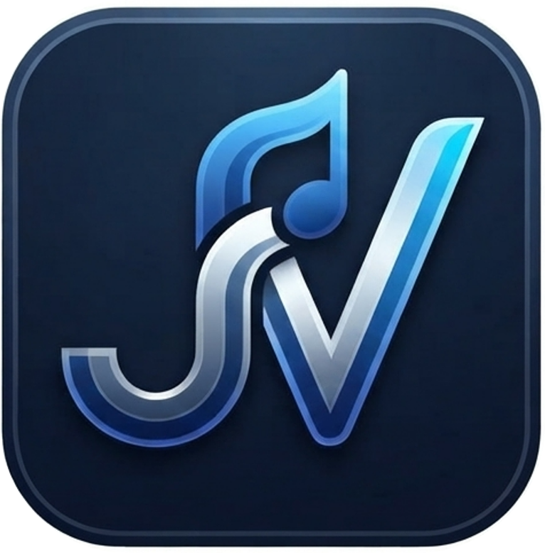

# Nitraxx Music

<p align="center">
  
</p>

Aplicación Android con React Native y Expo.

## Funciones

- Logo personalizado para el icono, la pantalla de inicio y la web.
- Reproducción en segundo plano, notificación multimedia y controles remotos mediante React Native Track Player.
- Playlists y favoritos guardados localmente en el dispositivo.
- Top de canciones y álbumes de España actualizado desde los charts de Apple Music, con botón para volver a cargar los datos.
- Búsqueda de artistas, álbumes y vistas previas de canciones con iTunes; búsqueda de videos y playlists de YouTube dentro de la app.
- Reproducción de videos y playlists de YouTube dentro de la app usando el reproductor oficial incrustado; los enlaces de YouTube Music se pueden pegar en la búsqueda.
- En Android, omisión de segmentos silenciosos dentro de la pista mediante ExoPlayer.
- Descargas únicamente para pistas que indiquen explícitamente `downloadAllowed: true` y proporcionen una URL HTTPS directa autorizada. Se descarga el archivo original sin conversión; no se extrae ni descarga audio de YouTube.
- Inicio de sesión Google sin Firebase ni backend; permite el acceso de solo lectura necesario para buscar en YouTube.

Android Auto, el ecualizador y el crossfade DJ entre pistas requieren una integración adicional del motor/servicio nativo; no se anuncian como disponibles. El salto de silencios no es un crossfade: elimina los segmentos silenciosos detectados dentro de una pista.
La búsqueda de canciones y playlists públicas usa YouTube y requiere iniciar sesión con Google; las canciones se filtran por la categoría Música de YouTube y la búsqueda de playlists incluye las listas de YouTube Music. Artistas y álbumes se buscan con iTunes. Spotify no está integrado. La reproducción de YouTube no se ejecuta en segundo plano; el modo de reproducción en segundo plano de Track Player aplica a pistas con URL de audio autorizada. La descarga conserva la calidad de origen disponible y no promete calidad alta ni convierte archivos.

## Crear un APK universal de prueba

El perfil `universal` de EAS genera un APK de distribución interna sin divisiones por ABI:

```bash
npx eas login
npx eas build --platform android --profile universal
```

## Crear un APK local sin créditos de EAS

Se necesita JDK 21 y Android SDK configurado. Desde la raíz del proyecto:

```bash
cd android
./gradlew assembleRelease
```

En Windows, usa `gradlew.bat assembleRelease` dentro de `android`. El APK se genera en `android/app/build/outputs/apk/release/app-release.apk`.

Para que Google Sign-In y las búsquedas de YouTube funcionen, habilita **YouTube Data API v3** en el proyecto de Google Cloud asociado, configura la pantalla de consentimiento para el permiso `youtube.readonly` y registra un cliente Android con el paquete `com.nitraxx.music.player` y el SHA-1 del certificado usado para firmar el APK. Un error de Google con código 10 normalmente indica que el paquete o el SHA-1 no coincide con ese cliente OAuth. El Client ID web se configura en `expo.extra.googleWebClientId` de [app.json](./app.json). La primera búsqueda de canciones o playlists pide iniciar sesión y autorizar YouTube.

## Validar

```bash
npx expo install --check
npx expo export --platform android
```
